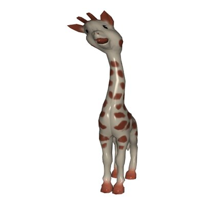

# Dynamic Skinning

[](https://github.com/drohmer/dynamic_skinning/actions/workflows/build.yml)

Implementation of the paper:

> **Dynamic Skinning: Kinematics-Driven Cartoon Effects for Articulated Characters**<br>
> Damien Rohmer, Karim Salem, Niranjan Kalyanasundaram, Victor Zordan<br>
> *IEEE Transactions on Visualization and Computer Graphics*, 2026. DOI: [10.1109/TVCG.2026.3653317](https://doi.org/10.1109/TVCG.2026.3653317)<br>
> Author's version: [`paper/Dynamic_Skinning_TVCG2026_author_version.pdf`](paper/Dynamic_Skinning_TVCG2026_author_version.pdf)

Dynamic skinning adds real-time, cartoon-like secondary deformations (lag, oscillations, propagation) to a skinned animated character, driven by the angular velocity of its joints.

<table>
<tr>
<td align="center"><br>Giraffe</td>
<td align="center"><br>Clown</td>
<td align="center"><br>Dragon</td>
<td align="center"><br>Cthulhu</td>
</tr>
<tr>
<td align="center"><br>Cylinder</td>
<td align="center"><br>Snail</td>
<td align="center" colspan="2"><br>Train (delay)</td>
</tr>
</table>


## Content

- **`code/`**: the C++ code, with two applications.
  - **`app_complete/`**: the complete application (executable `complete`): all the models, CPU or GPU skinning, joint manipulation with the mouse, delay (dLBS). It also has a web version.
  - **`app_minimal/`**: a minimal application (executable `minimal`), on the CPU, with three models. It is the simplest code showing how to use the method (see its [README](code/app_minimal/README.md)).
  - **`dynamic_skinning_source/`**: the method itself, shared by the two applications.
  - **`lib_helper/`**: animated character (skeleton, skinning, animations) and loading of the models.
  - **`cgp/`**: the [cgp](https://github.com/drohmer/cgp-2027) graphics library; **`shaders/`**, **`assets/`**: shaders and models.
- **`blender_addon/`**: a prototype of Blender add-on (see its [README](blender_addon/README.md)).
- **`paper/`**: the author's version of the paper.
- **`docs/`**: the images of this README.


## Build

Dependencies: a C++17 compiler, CMake (3.16 or later), OpenGL 3.3 and GLFW.

- **macOS:** `brew install cmake glfw`
- **Linux (Debian, Ubuntu):** `sudo apt install cmake pkg-config libglfw3-dev`
- **Windows:** Visual Studio, with CMake. GLFW is provided in `cgp/third_party/`.

From the `code/` directory:

```bash
cd code
cmake -S . -B build -DCMAKE_BUILD_TYPE=Release
cmake --build build -j
build/complete    # complete application
build/minimal     # minimal application
```

With Visual Studio: `cmake --build build --config Release`; `complete.exe` is written in `code/` and `minimal.exe` in `code\build\Release\`.

The programs find `shaders/` and `assets/` from the current directory: run them from `code/`, or from the directory of the application.

Other ways to build, also from `code/`:
- **Makefile:** `make` builds the two applications (`./complete` and `./minimal`), `make complete` only one.
- **A single application:** `cd app_minimal && cmake -B build && cmake --build build`.
- **Web version** (complete application, with [Emscripten](https://emscripten.org)):
  ```bash
  emcmake cmake -S . -B build_emscripten -DCMAKE_BUILD_TYPE=Release
  emmake make -C build_emscripten -j
  cd build_emscripten && emrun index.html
  ```

In Debug mode, the index checks of cgp are active and the CPU skinning is much slower: use Release for performance.


## Using the complete application

- **Model:** choice of the model. **Play:** starts the animation of the model.
- **Dynamic skinning:** enables or disables the effect. **Delay:** enables the delay.
- **Bone edit / Camera (Tab):** in Bone edit mode, a left click on a joint followed by a drag rotates it, and a right click twists it around its axis. In Camera mode, the camera rotates (left click) and zooms (right click or wheel).
- **Settings:** advanced settings (GPU skinning, display, timings).

Parameters, with the notations of the paper:
- **f, τ, A:** frequency, damping and amplitude of the oscillation kernel κ(t) = A exp(−t/τ) sin(2πf t) (section *Modeling Dynamic Oscillation Effects*).
- **D:** weight of the drag, i.e. the lag proportional to the velocity (appendix *Drag effect*).
- **c:** propagation speed of the delay (section *Time Delay Filter*, *Delayed Linear Blend Skinning*).
- **Local centers** (Clown): flexible origins of the deformations (section *Deformation origin control*).
- **Weights** (Cthulhu): displays the per-vertex bend weights, which restrict the deformation to the floppy parts (section *Weighted deformers*).

To save images automatically: `DS_CAPTURE_DIR=captures DS_CAPTURE_MODEL=Giraffe DS_CAPTURE_TIMES="1.0,1.5" build/complete`. The options are described in [`code/app_complete/capture/frame_capture.hpp`](code/app_complete/capture/frame_capture.hpp).


## Replicability

The script [`replicability/teaser.sh`](replicability/teaser.sh) ([`teaser.bat`](replicability/teaser.bat) on Windows) builds the code and reproduces the frames of the teaser figure of the paper (giraffe, clown and train examples) in `replicability/output/teaser/`. The installation of the dependencies on a vanilla macOS, Ubuntu or Windows, and the description of the output, are given in [`replicability.txt`](replicability.txt).


## Blender add-on

`blender_addon/` contains a prototype of extension for Blender (5.0 and later) that adds dynamic skinning (oscillations and drag) to a rigged mesh. The mesh reacts when a bone is manipulated in Pose Mode and during the playback of the animation.

<p align="center"></p>

### Installation

1. Download [`dynamic_skinning-0.1.0.zip`](https://github.com/drohmer/dynamic_skinning/releases/download/blender-addon-v0.1.0/dynamic_skinning-0.1.0.zip) (see the [releases](https://github.com/drohmer/dynamic_skinning/releases)).
2. In Blender: *Edit > Preferences > Get Extensions*, then the *▾* menu at the top right, *Install from Disk…*, and select `dynamic_skinning-0.1.0.zip`.

The zip can also be built from the repository: `blender --command extension build --source-dir blender_addon/dynamic_skinning --output-dir .` (on macOS, `blender` is `/Applications/Blender.app/Contents/MacOS/Blender`).

### Try the example

Open `blender_addon/examples/spot.blend` and press *Space* to play the animation: the head of Spot nods and turns, and the ears follow with a lag and oscillate. The armature is in Pose Mode: you can also select a bone and rotate it with *R*.

### Use on your own character

1. Select a mesh deformed by an *Armature* modifier (vertex groups named after the bones).
2. In *Properties > Object > Dynamic Skinning* (or in the 3D View sidebar, *N > Dyn. Skinning*), click *Enable*.
3. Switch the armature to Pose Mode and rotate a bone, or play the animation.

The parameters can be changed while the mesh moves:

| Parameter | Effect |
|---|---|
| Frequency f (Hz) | speed of the oscillations |
| Damping τ (s) | how long the oscillations last |
| Amplitude A | strength of the oscillations after a motion |
| Drag D | lag during the motion |
| Bend γ | overall strength of the deformation |

*Reset* recomputes the weights after a change of the rig or of the mesh; *Disable* removes the effect. More details (per-vertex bend weights, how it works, limitations) are given in the [README of the add-on](blender_addon/README.md).


## License

MIT, see [`LICENSE.md`](LICENSE.md).
