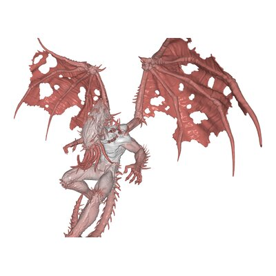
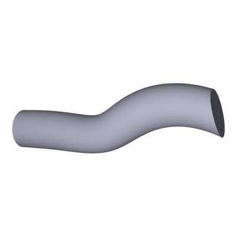
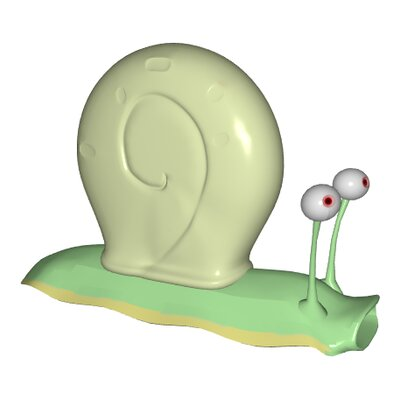
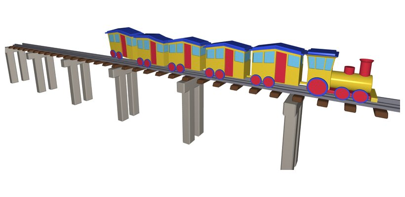
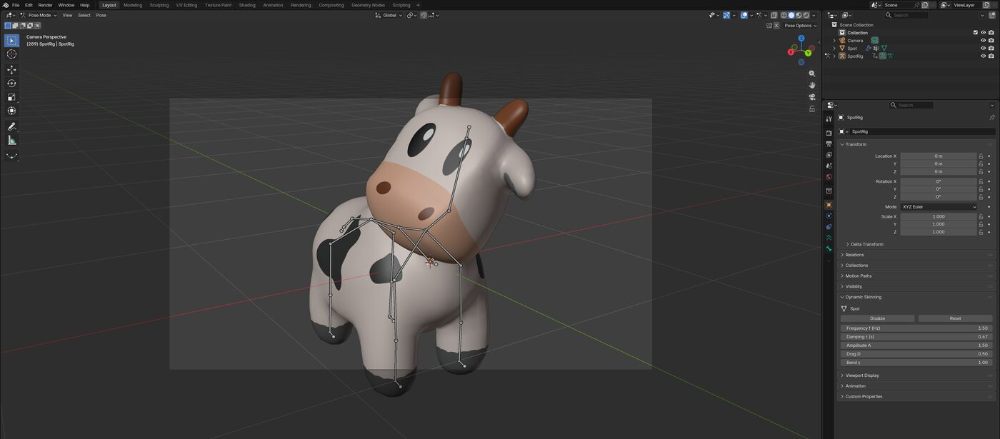

# Dynamic Skinning

Implémentation de l'article :

> **Dynamic Skinning: Kinematics-Driven Cartoon Effects for Articulated Characters**<br>
> Damien Rohmer, Karim Salem, Niranjan Kalyanasundaram, Victor Zordan<br>
> *IEEE Transactions on Visualization and Computer Graphics*, 2026. DOI : [10.1109/TVCG.2026.3653317](https://doi.org/10.1109/TVCG.2026.3653317)<br>
> Version auteur : [`paper/Dynamic_Skinning_TVCG2026_author_version.pdf`](paper/Dynamic_Skinning_TVCG2026_author_version.pdf)

Le dynamic skinning ajoute en temps réel des déformations secondaires de style cartoon (retard, oscillations, propagation) à un personnage animé par skinning, à partir de la vitesse angulaire de ses joints.

<table>
<tr>
<td align="center"><br>Girafe</td>
<td align="center"><br>Clown</td>
<td align="center"><br>Dragon</td>
<td align="center"><br>Cthulhu</td>
</tr>
<tr>
<td align="center"><br>Cylindre</td>
<td align="center"><br>Escargot</td>
<td align="center" colspan="2"><br>Train (délai)</td>
</tr>
</table>


## Contenu

- **`code/`** : le code C++, avec deux applications.
  - **`app_complete/`** : l'application complète (exécutable `complete`) : tous les modèles, skinning CPU ou GPU, manipulation des joints à la souris, délai (dLBS). Elle existe aussi en version web.
  - **`app_minimal/`** : une application minimale (exécutable `minimal`), en CPU, sur trois modèles. C'est le code le plus simple pour voir comment utiliser la méthode (voir son [README](code/app_minimal/README.md)).
  - **`dynamic_skinning_source/`** : la méthode elle-même, partagée par les deux applications.
  - **`lib_helper/`** : personnage animé (squelette, skinning, animations) et chargement des modèles.
  - **`cgp/`** : la bibliothèque graphique [cgp](https://github.com/drohmer/cgp-2027) ; **`shaders/`**, **`assets/`** : shaders et modèles.
- **`blender_addon/`** : un prototype d'add-on Blender (voir son [README](blender_addon/README.md)).
- **`paper/`** : la version auteur de l'article.
- **`docs/`** : les images de ce README.


## Compilation

Dépendances : un compilateur C++17, CMake (3.16 ou plus), OpenGL 3.3 et GLFW.

- **macOS :** `brew install cmake glfw`
- **Linux (Debian, Ubuntu) :** `sudo apt install cmake pkg-config libglfw3-dev`
- **Windows :** Visual Studio, avec CMake. GLFW est fourni dans `cgp/third_party/`.

Depuis le répertoire `code/` :

```bash
cd code
cmake -S . -B build -DCMAKE_BUILD_TYPE=Release
cmake --build build -j
build/complete    # application complète
build/minimal     # application minimale
```

Avec Visual Studio : `cmake --build build --config Release` ; `complete.exe` est écrit dans `code/` et `minimal.exe` dans `code\build\Release\`.

Les programmes trouvent `shaders/` et `assets/` à partir du répertoire courant : lancez-les depuis `code/`, ou depuis le répertoire de l'application.

D'autres façons de compiler, toujours depuis `code/` :
- **Makefile :** `make` compile les deux applications (`./complete` et `./minimal`), `make complete` une seule.
- **Une application seule :** `cd app_minimal && cmake -B build && cmake --build build`.
- **Version web** (application complète, avec [Emscripten](https://emscripten.org)) :
  ```bash
  emcmake cmake -S . -B build_emscripten -DCMAKE_BUILD_TYPE=Release
  emmake make -C build_emscripten -j
  cd build_emscripten && emrun index.html
  ```

En mode Debug, les vérifications d'indices de cgp sont actives et le skinning CPU est nettement plus lent : utilisez Release pour la performance.


## Utilisation de l'application complète

- **Model :** choix du modèle. **Play :** lance l'animation du modèle.
- **Dynamic skinning :** active ou désactive l'effet. **Delay :** active le délai.
- **Bone edit / Camera (Tab) :** en mode Bone edit, un clic gauche sur un joint puis un glisser le fait tourner, et un clic droit le fait tourner sur lui-même. En mode Camera, on fait tourner la caméra (clic gauche) et on zoome (clic droit ou molette).
- **Settings :** réglages avancés (skinning GPU, affichage, timings).

Paramètres, avec les notations de l'article :
- **f, τ, A :** fréquence, amortissement et amplitude du noyau d'oscillation κ(t) = A exp(−t/τ) sin(2πf t) (section *Modeling Dynamic Oscillation Effects*).
- **D :** poids du drag, c'est-à-dire le retard proportionnel à la vitesse (annexe *Drag effect*).
- **c :** vitesse de propagation du délai (section *Time Delay Filter*, *Delayed Linear Blend Skinning*).
- **Local centers** (Clown) : origines flexibles des déformations (section *Deformation origin control*).
- **Weights** (Cthulhu) : affiche les poids de bend par sommet, qui limitent la déformation aux parties souples (section *Weighted deformers*).

Pour enregistrer automatiquement des images : `DS_CAPTURE_DIR=captures DS_CAPTURE_MODEL=Girafe DS_CAPTURE_TIMES="1.0,1.5" build/complete`. Les options sont décrites dans [`code/app_complete/capture/frame_capture.hpp`](code/app_complete/capture/frame_capture.hpp).


## Add-on Blender

`blender_addon/` contient un prototype d'extension pour Blender (5.0 et plus) qui applique le dynamic skinning (oscillations et drag) à un maillage riggé. Le calcul est fait en Python et numpy, et le décalage de chaque sommet est ajouté par un modificateur Geometry Nodes placé après l'Armature. Le maillage réagit quand on manipule un os en Pose Mode et pendant la lecture de l'animation. Les paramètres f, τ, A, D et γ se règlent dans *Properties > Object > Dynamic Skinning*.

<p align="center"></p>

Le fichier d'exemple `blender_addon/examples/spot.blend` contient Spot avec son animation (ci-dessus, la tête tourne et les oreilles suivent avec retard). L'installation et l'utilisation sont décrites dans le [README de l'add-on](blender_addon/README.md).


## Licence

MIT, voir [`LICENSE.md`](LICENSE.md).
